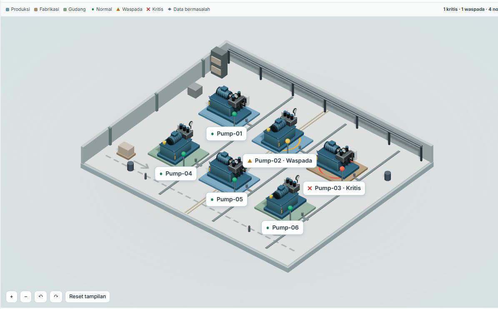
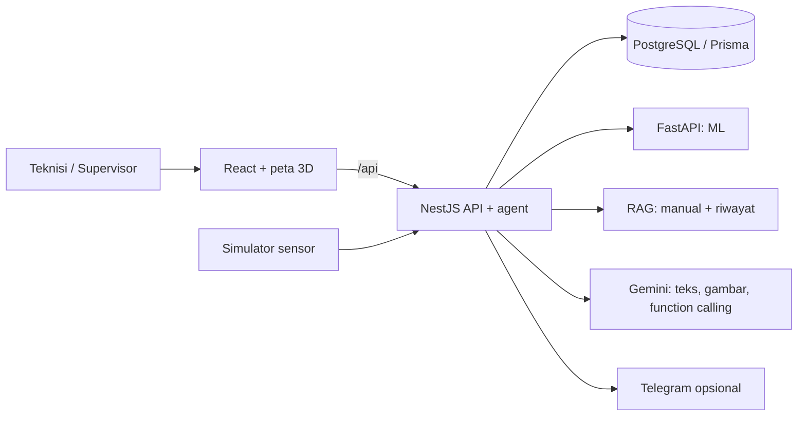

# ManualMechanic — GTNIC

Dashboard 3D dan AI agent untuk membantu tim maintenance memantau unit tenaga hidrolik, meninjau dugaan gangguan, dan menindaklanjutinya melalui kasus serta work order.

Prototipe untuk GTNIC 2026, kategori AI Agent. Sistem menggabungkan visualisasi mesin, model machine learning, pencarian manual perawatan, dan aturan persetujuan manusia dalam satu alur kerja.

> Prototipe memakai pembacaan simulasi dan data tersimpan dari profil dataset. Pada pemeriksaan 8 November 2026, ML production melaporkan `uci_real`, sedangkan simulator dan agent otomatis dinonaktifkan. Bentuk serta posisi mesin bersifat ilustratif. Integrasi sensor pabrik masih dalam rencana pengembangan.

## Coba aplikasi dan akun demo

**Website:** [manualmechanic-gtnic.vercel.app](https://manualmechanic-gtnic.vercel.app)

| Peran | Username | Password | Contoh penggunaan |
| --- | --- | --- | --- |
| Owner (akses supervisor) | `mumtaz` | `verstappen` | Meninjau persetujuan kasus dan mengelola inventaris |
| Teknisi | `farras` | `leclerc` | Membaca kondisi mesin, melaporkan gejala, dan menyelesaikan work order |

Kedua akun bersama ini disediakan untuk penilaian demo; login dan perannya diperiksa pada 8 November 2026. Aksi supervisor dapat mengubah data demo. Mohon pertahankan username dan password selama penilaian. Untuk instalasi sendiri, buat akun dan secret melalui langkah setup di bawah.

Alur mencoba aplikasi:

1. Login lalu pilih objek atau label mesin pada peta.
2. Buka panel unit, detail sensor, atau kasus terkait. Gunakan **Analisis unit ini** untuk memulai diagnosis jika tersedia.
3. Di **Asisten**, aktifkan **Mode LLM** melalui **Pengaturan agent**. Tulis keluhan seperti “Pump-03 oli cepat panas dan tekanan sulit naik”.
4. Untuk bukti visual, pilih **Tambah gambar**, periksa pratinjau, tambahkan pesan bila perlu, lalu **Kirim**. Mendukung satu JPG/PNG/WebP maksimal 2 MB.
5. Buka **Lihat jejak** untuk memeriksa tool dan tindakan yang benar-benar tercatat. Supervisor dapat meninjau kasus yang menunggu persetujuan.

**Status layanan → Uji Gemini** memeriksa koneksi LLM dan memakai kuota API. Demo Vercel memakai pembacaan tersimpan; klik refresh mengambil data terbaru yang tersedia, sedangkan simulasi yang berjalan terus memerlukan backend persisten.



*Cuplikan peta 3D dari proposal tim CPESS, halaman 10. Warna merupakan status pada saat screenshot dibuat; kondisi pada demo dapat berubah.*

## Fitur

- **Dashboard 3D:** enam unit demo memakai model GLB hasil Blender, pencahayaan, bayangan, zona, serta konteks area pabrik. Objek mengikuti daftar unit backend. Klik mesin membuka panel status, dugaan ML, alasan perhatian, kasus, dan work order.
- **Interaksi peta:** zoom, pan saat diperbesar, fokus ke unit, rotasi 90°, hover/seleksi, dan **Reset tampilan** yang mempertahankan panel. Label bisa diakses dengan keyboard dan tersedia daftar unit alternatif. Denyut berhenti setelah delapan detik atau saat tab tidak aktif; reduced motion mematikannya.
- **Monitoring dan ML:** validasi sensor, deteksi anomali dengan Isolation Forest, dan klasifikasi kondisi pompa, katup, pendingin, serta akumulator dengan Random Forest.
- **Agent maintenance:** diagnosis, pertanyaan klarifikasi, eskalasi, persetujuan supervisor, pemeriksaan stok, work order, pengajuan pembelian, dan penugasan teknisi. Supervisor dapat memilih/mengganti teknisi dari Work order dengan pemeriksaan keahlian, senior, ketersediaan, serta alasan kegagalan yang tetap terlihat.
- **Tugas saya untuk supervisor:** antrean persetujuan, pekerjaan aktif tanpa teknisi, dan kasus eskalasi. Penugasan dapat dilakukan langsung dari antrean; jumlah total dan tautan daftar lengkap mengikuti data backend.
- **RAG bersitasi:** pencarian manual Markdown dan riwayat perawatan menggunakan TF-IDF serta cosine similarity.
- **Chat teks dan gambar:** Gemini menerima keluhan beserta satu gambar. Lampiran dapat dihapus dan dicoba ulang saat permintaan gagal. Riwayat sesi menyimpan teks serta nama lampiran; hanya tiga pratinjau foto terbaru berada di memori sampai halaman dimuat ulang.
- **Hasil tercatat pada chat:** snapshot status kasus, work order, teknisi/jadwal, dan pengajuan part dibaca dari database untuk memeriksa hasil jawaban agent. Snapshot dapat mencakup pekerjaan yang sudah ada sebelum pesan terakhir.
- **Operasional:** kasus dan work order dengan filter/paginasi, inventaris beserta riwayat stok, notifikasi, profil pengguna, dan autentikasi sesi.
- **UX dan ketahanan:** detail unit dengan jalan kembali ke peta, action bar persetujuan, pesan gagal yang menetap, konfirmasi dalam halaman, perlindungan isian, tampilan WO ponsel, serta cache data dengan status offline/kesegaran.
- **Integrasi opsional:** Gemini untuk function calling dan Telegram untuk pengiriman notifikasi.

Mode policy dapat berjalan tanpa Gemini. Hasil analisis tidak langsung mengendalikan perangkat fisik; tindakan sistem berupa pencatatan dan koordinasi pekerjaan maintenance.

Pengamanan risiko, rencana persetujuan LLM, konteks kasus chat, batas waktu, dan retensi foto telah diperbaiki serta diuji. Hasil dan batas verifikasinya ada di [validasi agent](docs/AGENT_VALIDATION_2026-11-08.md). Verifikasi lokal tidak berarti versi production sudah diperbarui.

## Arsitektur



| Bagian | Teknologi |
| --- | --- |
| Web | React 18, TypeScript, Vite 8, TanStack Query |
| Visualisasi | React Three Fiber 8, Drei, Three.js, aset GLB hasil Blender |
| Backend | NestJS 12, Prisma 7, PostgreSQL |
| ML | Python, FastAPI, scikit-learn |
| Tes | Vitest, Testing Library, Jest, Supertest, PGlite terisolasi, pytest |

## Dataset dan hasil evaluasi

Artefak terbaru memakai **UCI Condition Monitoring of Hydraulic Systems**, dengan 2.205 siklus dan 34 fitur agregat dari 17 sensor. Split acak stratifikasi 75/25 menghasilkan 1.653 siklus latih dan 552 siklus uji.

| Komponen | Akurasi uji acak | Macro-F1 | Akurasi split berurutan |
| --- | --- | --- | --- |
| Pendingin | 99,82% | 0,9982 | 100,00% |
| Katup | 98,73% | 0,9855 | 34,78% |
| Pompa | 99,82% | 0,9981 | 73,01% |
| Akumulator | 98,91% | 0,9875 | 27,72% |

Sumber angka adalah [metrics.json](ml/artifacts/metrics.json) dan [overfit_check.json](ml/artifacts/overfit_check.json), yang dicocokkan dengan kode evaluasi. Metadata model production pada 8 November 2026 cocok dengan metrik uji acak tersebut. Evaluasi split berurutan memakai urutan baris dataset; hasilnya menunjukkan generalisasi yang jauh lebih lemah untuk beberapa komponen.

Isolation Forest mendeteksi 75,27% siklus bergangguan pada split uji tersebut. Alarm palsu 0% hanya berasal dari enam siklus sehat uji, sehingga bukti kondisi sehat masih sangat terbatas. Penggunaan lapangan memerlukan evaluasi pada mesin sasaran serta kalibrasi keyakinan. Rincian ada di [dokumentasi dataset](docs/DATASET.md).

## Mulai di Windows / PowerShell

Prasyarat: Node.js **24** direkomendasikan, Python **3.12** sebagai acuan image ML, dan database PostgreSQL yang dapat diakses. Kompatibilitas paket Python mengikuti [requirements ML](ml/requirements.txt).

Jalankan perintah dari root checkout repositori. Gunakan tiga terminal terpisah.

### 1. Layanan ML — port 8100

```powershell
Set-Location .\ml
py -3.12 -m venv .venv
.\.venv\Scripts\python.exe -m pip install -r requirements.txt
.\.venv\Scripts\python.exe -m uvicorn app:app --port 8100
```

Cek `http://localhost:8100/health`. Bila artefak tidak ada atau versi scikit-learn berbeda, hentikan ML dan latih ulang pada environment yang sama:

```powershell
# Dataset UCI; membutuhkan internet.
.\.venv\Scripts\python.exe train.py --download

# Alternatif khusus demo sintetis; pilih salah satu perintah training.
# .\.venv\Scripts\python.exe train.py --demo
```

Training mengganti model, profil simulator, dan metrik. Restart ML serta backend setelah training. Jangan mencampur model dan profil dari hasil training berbeda.

### 2. Backend — port 8000

```powershell
Set-Location .\backend
npm.cmd ci
if (!(Test-Path .env)) { Copy-Item .env.example .env }
# Isi DATABASE_URL di .env. DIRECT_URL opsional untuk koneksi migrasi.
npm.cmd run db:migrate
npm.cmd run auth:setup
```

Setup akun menulis kredensial bootstrap ke `backend/.auth-bootstrap.json`, yang diabaikan Git. Baca file tersebut secara lokal dan simpan kredensial dengan aman. Jangan membagikan atau mengunggahnya.

Untuk database demo baru, set `SEED_DEMO_DATA=true` di `backend/.env` sebelum startup pertama agar enam unit, inventaris, teknisi, dan riwayat awal dibuat. Setelah berhasil, kembalikan ke `false`. Backend tidak menerapkan migrasi otomatis pada startup Node biasa.

```powershell
npm.cmd run start:dev
```

### 3. Frontend — port 5173

```powershell
Set-Location .\frontend
npm.cmd ci
npm.cmd run dev
```

Buka `http://localhost:5173`. Proxy Vite meneruskan `/api` ke port 8000. Backend dan ML memakai port berbeda sehingga dapat berjalan bersamaan.

Jika konfigurasi CORS masih mengikuti contoh, gunakan `localhost:5173`; penggunaan `127.0.0.1:5173` perlu dimasukkan juga ke `FRONTEND_ORIGIN`.

## Data demo dan penambahan mesin

Data awal berisi `Pump-01` sampai `Pump-06`. Pada database lama yang masih memiliki empat unit:

```powershell
Set-Location .\backend
npm.cmd run demo:add-pumps
```

Perintah ini hanya menambahkan `Pump-05` dan `Pump-06` bila ID belum ada. Data mesin yang sudah terdaftar tidak ditimpa. Restart backend agar simulator memuat unit baru; dashboard mengikuti daftar dari `/api/overview` pada pembaruan berikutnya.

Untuk membuat kasus demo berdasarkan inferensi ML, hentikan backend terlebih dahulu, pastikan ML aktif, lalu jalankan `npm.cmd run demo:seed`. Perintah ini dapat membuat kasus, work order, jadwal, dan catatan notifikasi. Jumlah serta statusnya mengikuti hasil diagnosis. Lihat [panduan teknis](docs/TECHNICAL.md#data-demo-dan-pendaftaran-unit).

## Konfigurasi penting

| Variabel backend | Fungsi |
| --- | --- |
| `DATABASE_URL`, `DIRECT_URL` | Koneksi runtime dan migrasi PostgreSQL |
| `JWT_SECRET`, `AUTH_ENABLED` | Autentikasi; secret acak minimal 32 karakter |
| `FRONTEND_ORIGIN` | Daftar origin frontend yang diizinkan |
| `ML_URL`, `ML_API_KEY` | Koneksi dan kunci layanan ML |
| `SIM_ENABLED`, `TICK_SECONDS` | Simulator dan interval siklus |
| `AUTO_AGENT`, `DEMO_SCENARIO` | Pemantauan otomatis dan skenario demo |
| `GEMINI_API_KEY`, `GEMINI_MODEL` | Mode LLM opsional |
| `TELEGRAM_BOT_TOKEN`, `TELEGRAM_CHAT_ID` | Pengiriman Telegram opsional |

Daftar contoh: [backend/.env.example](backend/.env.example). Frontend menggunakan `VITE_API_URL`, default `/api`. Rahasia hanya berada di backend/ML, tidak di variabel frontend.

Environment Vercel Production dikelola pada project **`manualmechanic-api`**. Mengedit `backend/.env` lokal tidak memperbarui konfigurasi tersebut. `ML_URL` mengatur layanan sensor ML; `GEMINI_API_KEY` dan `GEMINI_MODEL` mengatur LLM. Setelah perubahan environment, deploy backend dan periksa kedua layanan secara terpisah.

## Cache dan keamanan

- React Query menyimpan data API di memori browser. Default data dianggap segar 30 detik dan cache yang tidak digunakan dibersihkan setelah lima menit; overview melakukan polling 15 detik. Perubahan operasional memicu invalidasi cache terkait.
- Cache privat dibersihkan saat sesi berganti. Riwayat chat disimpan di session storage per username sampai logout; byte gambar tidak ikut disimpan di sana.
- Password akun disimpan sebagai hash scrypt. Access JWT dan refresh token memakai cookie HttpOnly; refresh token dirotasi dan sesi dapat dicabut. Izin teknisi/supervisor diperiksa backend. Sesi dibatasi 30 menit idle dan delapan jam dari login; polling/refresh tidak memperpanjangnya. Cookie mengikuti sesi browser dengan batas waktu server tetap berlaku.
- Origin eksplisit, validasi DTO, header klien untuk mutasi, Helmet, CSP, serta batas body membantu melindungi API. Batas body umum 128 KB; `/api/chat` dibatasi 3 MB untuk membawa gambar maksimal 2 MB setelah decoding.
- Rate limiter berbasis PostgreSQL membatasi permintaan global, login, AI, dan operasi sensitif. Nilai default global 600/menit/IP, login 20/15 menit/IP, dan AI 20/menit/IP. Gangguan store limiter dapat menghasilkan 503.

Akun demo di atas sengaja dibagikan untuk evaluasi. API key, cookie, connection string database, dan secret deployment tetap dikelola secara privat. Temuan review terbuka ada di [laporan tinjauan](docs/REVIEW_2026-11-08.md).

## Tes dan build

```powershell
# Jalankan dari folder masing-masing.
# frontend/
npm.cmd test
npm.cmd run build

# backend/ — ML harus aktif untuk suite integrasi lengkap.
npm.cmd test
npm.cmd run build

# ml/ — pytest dipasang terpisah dari dependensi runtime.
.\.venv\Scripts\python.exe -m pip install pytest
.\.venv\Scripts\python.exe -m pytest -q
```

Tes backend menggunakan PostgreSQL melalui PGlite terisolasi, bukan database aplikasi. Tes yang lulus tidak membuktikan performa pada mesin fisik, keberhasilan Telegram/Gemini live, atau kesiapan deployment produksi.

Pemeriksaan 8 November 2026, termasuk Tugas saya, ringkasan chat, reset navigasi login, dan startup, menghasilkan **75 tes frontend dan 93 tes backend lulus**. Backend mencakup 14 tes integrasi dengan layanan ML proyek; tes orkestrasi memakai respons Gemini terkontrol dan database lokal terisolasi. Uji browser headless lokal pada 1440, 768, dan 380 px memeriksa antrean supervisor, penugasan gagal/retry, ringkasan chat, serta batas tampilan teknisi menggunakan API fixture. Pergantian akun dari Profil juga diuji pada desktop/ponsel dan kembali ke dashboard. Smoke Gemini live pada perbaikan sebelumnya memeriksa pertanyaan alasan dan stok pada kasus yang sudah dieskalasi. Pytest ML, penggunaan fitur baru di production, dan uji pengguna manusia belum diverifikasi. Rincian ada di [validasi agent](docs/AGENT_VALIDATION_2026-11-08.md).

## Docker dan deployment

[docker-compose.yml](docker-compose.yml) menyediakan PostgreSQL, ML, backend, dan frontend. Salin `.env.example` root ke `.env`, lengkapi konfigurasi autentikasi dan secret, lalu jalankan `docker compose up --build -d`. Buka `http://localhost:8080`. Data tetap tersimpan saat `docker compose down`; penghapusan volume akan menghapus data.

Untuk proses deploy, lihat [dokumentasi teknis](docs/TECHNICAL.md#deployment) dan [panduan Vercel](docs/VERCEL_WEB.md). Konfigurasi backend Vercel menonaktifkan simulator dan agent otomatis; demo yang terus bergerak membutuhkan proses backend persisten. Build atau status deployment berhasil saja belum cukup untuk menyatakan login, ML, dan database sudah berfungsi.

## Dokumentasi

| Dokumen | Isi |
| --- | --- |
| [PRD](docs/PRD.md) | Masalah, pengguna, ruang lingkup, kebutuhan, dan kriteria penerimaan |
| [Panduan pengguna](docs/USER_GUIDE.md) | Dashboard 3D, diagnosis, kasus, work order, inventaris, dan akun |
| [Uji dua peran](docs/USER_TEST.md) | Skenario supervisor/teknisi untuk juri dan lembar hasil uji pengguna; hasil manusia belum dikumpulkan |
| [Dokumentasi teknis](docs/TECHNICAL.md) | Komponen, data, konfigurasi, setup, 3D, ML, keamanan, dan troubleshooting |
| [Referensi API](docs/API.md) | Endpoint, hak akses, payload, dan respons penting |
| [Dataset](docs/DATASET.md) | Asal data, evaluasi, dan batasan generalisasi |
| [Perilaku cache](docs/UX_CACHE.md) | Cache, navigasi, offline, dan perubahan yang belum disimpan |
| [Tinjauan proposal dan implementasi](docs/REVIEW_2026-11-08.md) | Kesesuaian proposal CPESS, verifikasi fitur terbaru, serta temuan yang perlu diperbaiki |

Dokumen konsep lama [PROJECT_DETAIL.md](docs/PROJECT_DETAIL.md) dipertahankan sebagai arsip, bukan spesifikasi implementasi saat ini.

## Batasan

- Peta dan model mesin merupakan ilustrasi, bukan digital twin geometris atau simulasi fisika mesin.
- Warna dan denyut indikator mengikuti status analisis; hasil ML tidak membuktikan mesin sedang berhenti, bergetar, atau berputar.
- Belum ada formulir/API umum untuk mendaftarkan mesin, integrasi sensor MQTT/OPC-UA, ataupun integrasi ERP/CMMS eksternal.
- Keyakinan ML belum dikalibrasi untuk mesin pabrik pengguna. Dataset satu rig dan data sintetis tidak membuktikan akurasi lapangan.
- Penambahan riwayat membantu pencarian RAG; model ML tidak otomatis dilatih ulang dari pekerjaan yang selesai.
- Konteks chat memakai satu unit per kasus; sebut ID unit lain untuk berpindah. Pertanyaan alasan, stok, dan foto lanjutan tetap dapat dijawab pada kasus yang menunggu keputusan atau sudah dieskalasi, melalui mode baca saja yang tidak mengubah rencana maupun menjalankan tindakan baru.
- Memori chat dibatasi 100 pesan dan tiga pratinjau foto terbaru. Riwayat setelah reload berisi nama file dan teks; pemeriksaan visual ulang memerlukan pengunggahan kembali.
- Simulasi, snapshot data, dan koneksi layanan perlu diperiksa sebelum presentasi.

Referensi dataset: Helwig, N., Pignanelli, E., & Schütze, A. (2015), *Condition monitoring of hydraulic systems*, UCI Machine Learning Repository, DOI [10.24432/C5CW21](https://doi.org/10.24432/C5CW21). Ketentuan dataset mengikuti sumbernya. Lisensi penggunaan kode proyek belum ditetapkan dalam repositori.

## Pengelolaan akun tim

Owner memiliki seluruh akses supervisor dan dapat membuat/menonaktifkan supervisor. Supervisor dapat membuat akun teknisi melalui **Tim**. Teknisi melihat WO miliknya melalui **Tugas saya**. Akun baru tidak dapat memilih sendiri peran atau menaikkan hak akses.

Akun demo `mumtaz` ditetapkan sebagai Owner pertama atas pilihan pengelola. Profil teknisi demo lama perlu dihubungkan secara eksplisit ke akun login sebelum menerima penugasan baru pada mode autentikasi. Panduan langkah demi langkah ada di [Pengelolaan akun tim](docs/TEAM_ACCOUNTS.md).
