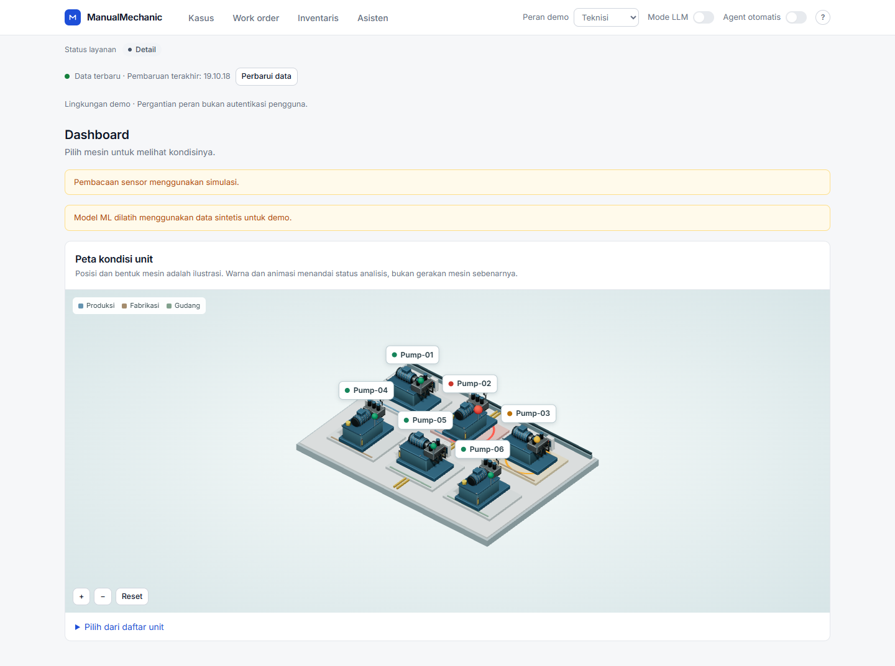
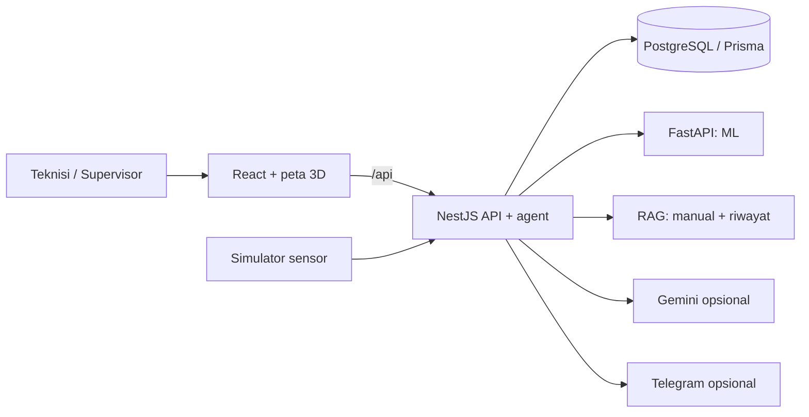

# ManualMechanic — GTNIC

Dashboard 3D dan AI agent untuk membantu tim maintenance memantau unit tenaga hidrolik, meninjau dugaan gangguan, dan menindaklanjutinya melalui kasus serta work order.

Prototipe untuk GTNIC 2026, kategori AI Agent. Sistem menggabungkan visualisasi mesin, model machine learning, pencarian manual perawatan, dan aturan persetujuan manusia dalam satu alur kerja.

> Data sensor saat ini berasal dari simulator. Model dapat menggunakan dataset UCI atau data sintetis, tergantung artefak yang dilatih. Bentuk dan posisi mesin pada peta bersifat ilustratif; sistem belum terhubung ke mesin pabrik nyata.



*Contoh dashboard dengan respons API data uji. Gambar ini menunjukkan antarmuka, bukan bukti koneksi sensor pabrik atau deployment produksi.*

## Fitur

- **Dashboard 3D:** objek mengikuti daftar unit dari backend; klik mesin untuk membuka status, dugaan ML, keyakinan, kasus, dan jumlah work order. Panel dapat ditutup untuk kembali ke peta penuh.
- **Monitoring dan ML:** validasi sensor, deteksi anomali dengan Isolation Forest, dan klasifikasi kondisi pompa, katup, pendingin, serta akumulator dengan Random Forest.
- **Agent maintenance:** diagnosis, pertanyaan klarifikasi, eskalasi, persetujuan supervisor, pemeriksaan stok, work order, pengajuan pembelian, dan penugasan teknisi.
- **RAG bersitasi:** pencarian manual Markdown dan riwayat perawatan menggunakan TF-IDF serta cosine similarity.
- **Operasional:** kasus dan work order dengan filter/paginasi, inventaris beserta riwayat stok, notifikasi, profil pengguna, dan autentikasi sesi.
- **Integrasi opsional:** Gemini untuk function calling dan Telegram untuk pengiriman notifikasi.

Mode policy dapat berjalan tanpa Gemini. Hasil analisis tidak langsung mengendalikan perangkat fisik; tindakan sistem berupa pencatatan dan koordinasi pekerjaan maintenance.

## Arsitektur



| Bagian | Teknologi |
| --- | --- |
| Web | React 18, TypeScript, Vite 8, TanStack Query |
| Visualisasi | React Three Fiber 8, Drei, Three.js, aset GLB hasil Blender |
| Backend | NestJS 12, Prisma 7, PostgreSQL |
| ML | Python, FastAPI, scikit-learn |
| Tes | Vitest, Testing Library, Jest, Supertest, PGlite terisolasi, pytest |

## Mulai di Windows / PowerShell

Prasyarat: Node.js **24** direkomendasikan, Python **3.12** sebagai acuan image ML, dan database PostgreSQL yang dapat diakses. Kompatibilitas paket Python mengikuti [requirements ML](ml/requirements.txt).

Jalankan perintah dari root checkout repositori. Gunakan tiga terminal terpisah.

### 1. Layanan ML — port 8100

```powershell
Set-Location .\ml
py -3.12 -m venv .venv
.\.venv\Scripts\python.exe -m pip install -r requirements.txt
.\.venv\Scripts\python.exe -m uvicorn app:app --port 8100
```

Cek `http://localhost:8100/health`. Bila artefak tidak ada atau versi scikit-learn berbeda, hentikan ML dan latih ulang pada environment yang sama:

```powershell
# Dataset UCI; membutuhkan internet.
.\.venv\Scripts\python.exe train.py --download

# Alternatif khusus demo sintetis; pilih salah satu perintah training.
# .\.venv\Scripts\python.exe train.py --demo
```

Training mengganti model, profil simulator, dan metrik. Restart ML serta backend setelah training. Jangan mencampur model dan profil dari hasil training berbeda.

### 2. Backend — port 8000

```powershell
Set-Location .\backend
npm.cmd ci
if (!(Test-Path .env)) { Copy-Item .env.example .env }
# Isi DATABASE_URL di .env. DIRECT_URL opsional untuk koneksi migrasi.
npm.cmd run db:migrate
npm.cmd run auth:setup
```

Setup akun menulis kredensial bootstrap ke `backend/.auth-bootstrap.json`, yang diabaikan Git. Baca file tersebut secara lokal dan simpan kredensial dengan aman. Jangan membagikan atau mengunggahnya.

Untuk database demo baru, set `SEED_DEMO_DATA=true` di `backend/.env` sebelum startup pertama agar enam unit, inventaris, teknisi, dan riwayat awal dibuat. Setelah berhasil, kembalikan ke `false`. Backend tidak menerapkan migrasi otomatis pada startup Node biasa.

```powershell
npm.cmd run start:dev
```

### 3. Frontend — port 5173

```powershell
Set-Location .\frontend
npm.cmd ci
npm.cmd run dev
```

Buka `http://localhost:5173`. Proxy Vite meneruskan `/api` ke port 8000. Backend dan ML memakai port berbeda sehingga dapat berjalan bersamaan.

Jika konfigurasi CORS masih mengikuti contoh, gunakan `localhost:5173`; penggunaan `127.0.0.1:5173` perlu dimasukkan juga ke `FRONTEND_ORIGIN`.

## Data demo dan penambahan mesin

Data awal berisi `Pump-01` sampai `Pump-06`. Pada database lama yang masih memiliki empat unit:

```powershell
Set-Location .\backend
npm.cmd run demo:add-pumps
```

Perintah ini hanya menambahkan `Pump-05` dan `Pump-06` bila ID belum ada. Data mesin yang sudah terdaftar tidak ditimpa. Restart backend agar simulator memuat unit baru; dashboard mengikuti daftar dari `/api/overview` pada pembaruan berikutnya.

Untuk membuat kasus demo berdasarkan inferensi ML, hentikan backend terlebih dahulu, pastikan ML aktif, lalu jalankan `npm.cmd run demo:seed`. Perintah ini dapat membuat kasus, work order, jadwal, dan catatan notifikasi. Jumlah serta statusnya mengikuti hasil diagnosis. Lihat [panduan teknis](docs/TECHNICAL.md#data-demo-dan-pendaftaran-unit).

## Konfigurasi penting

| Variabel backend | Fungsi |
| --- | --- |
| `DATABASE_URL`, `DIRECT_URL` | Koneksi runtime dan migrasi PostgreSQL |
| `JWT_SECRET`, `AUTH_ENABLED` | Autentikasi; secret acak minimal 32 karakter |
| `FRONTEND_ORIGIN` | Daftar origin frontend yang diizinkan |
| `ML_URL`, `ML_API_KEY` | Koneksi dan kunci layanan ML |
| `SIM_ENABLED`, `TICK_SECONDS` | Simulator dan interval siklus |
| `AUTO_AGENT`, `DEMO_SCENARIO` | Pemantauan otomatis dan skenario demo |
| `GEMINI_API_KEY`, `GEMINI_MODEL` | Mode LLM opsional |
| `TELEGRAM_BOT_TOKEN`, `TELEGRAM_CHAT_ID` | Pengiriman Telegram opsional |

Daftar contoh: [backend/.env.example](backend/.env.example). Frontend menggunakan `VITE_API_URL`, default `/api`. Rahasia hanya berada di backend/ML, tidak di variabel frontend.

## Tes dan build

```powershell
# Jalankan dari folder masing-masing.
# frontend/
npm.cmd test
npm.cmd run build

# backend/ — ML harus aktif untuk suite integrasi lengkap.
npm.cmd test
npm.cmd run build

# ml/ — pytest dipasang terpisah dari dependensi runtime.
.\.venv\Scripts\python.exe -m pip install pytest
.\.venv\Scripts\python.exe -m pytest -q
```

Tes backend menggunakan PostgreSQL melalui PGlite terisolasi, bukan database aplikasi. Tes yang lulus tidak membuktikan performa pada mesin fisik, keberhasilan Telegram/Gemini live, atau kesiapan deployment produksi.

## Docker dan deployment

[docker-compose.yml](docker-compose.yml) menyediakan PostgreSQL, ML, backend, dan frontend. Salin `.env.example` root ke `.env`, lengkapi konfigurasi autentikasi dan secret, lalu jalankan `docker compose up --build -d`. Buka `http://localhost:8080`. Data tetap tersimpan saat `docker compose down`; penghapusan volume akan menghapus data.

Untuk proses deploy, lihat [dokumentasi teknis](docs/TECHNICAL.md#deployment) dan [panduan Vercel](docs/VERCEL_WEB.md). Konfigurasi backend Vercel menonaktifkan simulator dan agent otomatis; demo yang terus bergerak membutuhkan proses backend persisten. Build atau status deployment berhasil saja belum cukup untuk menyatakan login, ML, dan database sudah berfungsi.

## Dokumentasi

| Dokumen | Isi |
| --- | --- |
| [PRD](docs/PRD.md) | Masalah, pengguna, ruang lingkup, kebutuhan, dan kriteria penerimaan |
| [Panduan pengguna](docs/USER_GUIDE.md) | Dashboard 3D, diagnosis, kasus, work order, inventaris, dan akun |
| [Dokumentasi teknis](docs/TECHNICAL.md) | Komponen, data, konfigurasi, setup, 3D, ML, keamanan, dan troubleshooting |
| [Referensi API](docs/API.md) | Endpoint, hak akses, payload, dan respons penting |
| [Dataset](docs/DATASET.md) | Asal data, evaluasi, dan batasan generalisasi |
| [Perilaku cache](docs/UX_CACHE.md) | Cache, navigasi, offline, dan perubahan yang belum disimpan |

Dokumen konsep lama [PROJECT_DETAIL.md](docs/PROJECT_DETAIL.md) dipertahankan sebagai arsip, bukan spesifikasi implementasi saat ini.

## Batasan

- Peta dan model mesin merupakan ilustrasi, bukan digital twin geometris atau simulasi fisika mesin.
- Warna dan denyut indikator mengikuti status analisis; hasil ML tidak membuktikan mesin sedang berhenti, bergetar, atau berputar.
- Belum ada formulir/API umum untuk mendaftarkan mesin, integrasi sensor MQTT/OPC-UA, ataupun integrasi ERP/CMMS eksternal.
- Keyakinan ML belum dikalibrasi untuk mesin pabrik pengguna. Dataset satu rig dan data sintetis tidak membuktikan akurasi lapangan.
- Penambahan riwayat membantu pencarian RAG; model ML tidak otomatis dilatih ulang dari pekerjaan yang selesai.
- Simulasi, snapshot data, dan koneksi layanan perlu diperiksa sebelum presentasi.

Referensi dataset: Helwig, N., Pignanelli, E., & Schütze, A. (2015), *Condition monitoring of hydraulic systems*, UCI Machine Learning Repository, DOI [10.24432/C5CW21](https://doi.org/10.24432/C5CW21). Ketentuan dataset mengikuti sumbernya. Lisensi penggunaan kode proyek belum ditetapkan dalam repositori.
